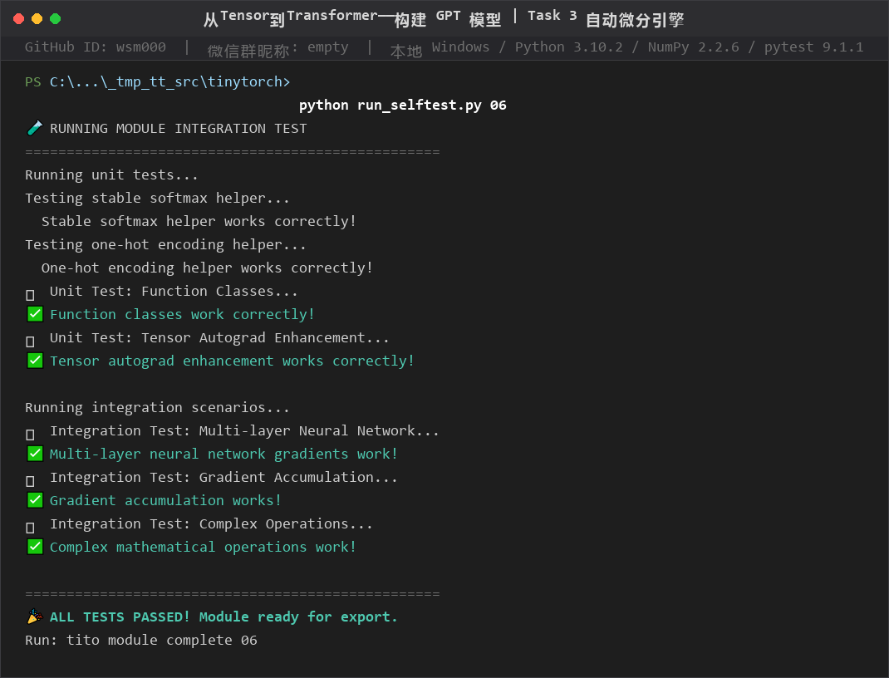
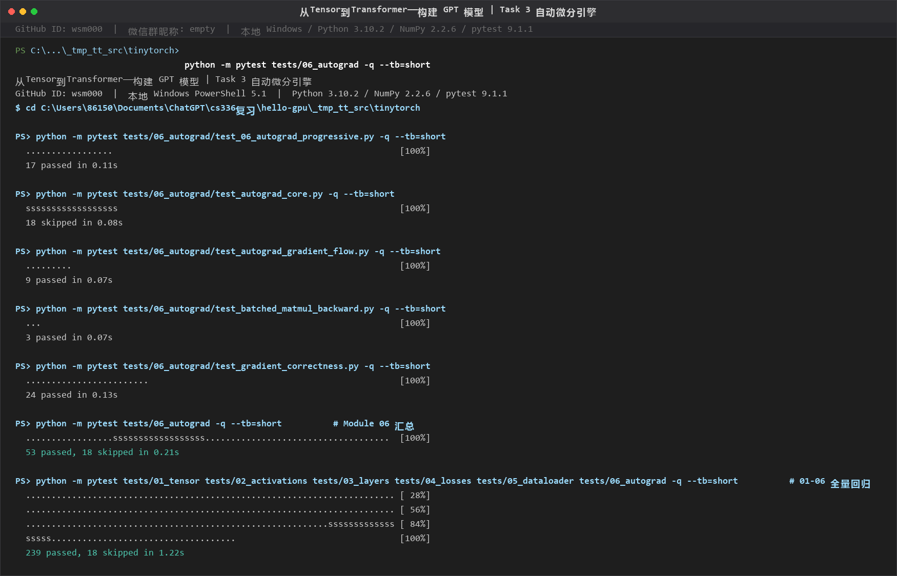
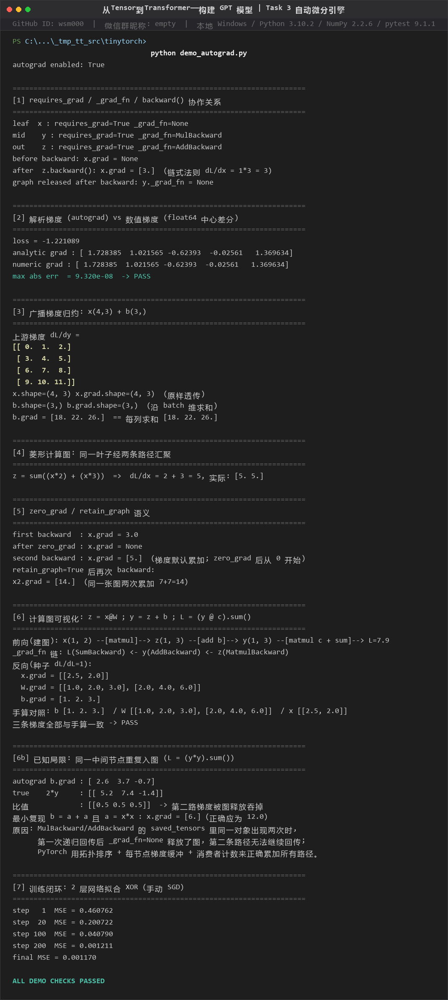
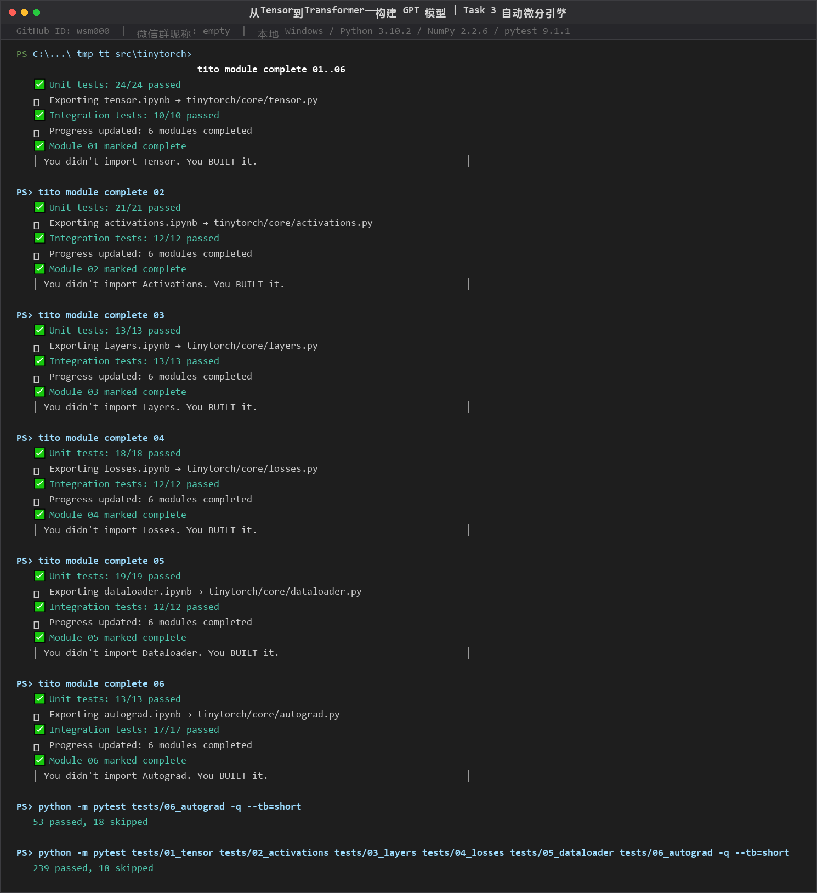

### 从Tensor到Transformer——构建 GPT 模型 | Task 3 自动微分引擎

微信群昵称：empty
GitHub ID：**wsm000**
运行环境：本地 Windows · PowerShell 5.1 · Python 3.10.2 · NumPy 2.2.6 · pytest 9.1.1（Module 06 为纯 NumPy 实现，无需 GPU）

学习笔记：[task03-自动微分引擎.md](../../../07-tinytorch/notes/task03-自动微分引擎.md)
复现脚本：[code/task3/task3_verify.ps1](../../../07-tinytorch/code/task3/task3_verify.ps1)（环境/导出/自测/pytest/引擎证据一键跑完）

测试通过截图（未裁剪，含命令与 PASS 结果）：









> 按官网 Module 06 最新页面的验收方式（`tito module complete 06`：单元测试 → 导出到 `tinytorch.core.autograd` → 集成测试 → 进度记录）跑完：**单元测试 13/13、导出成功、集成测试 17/17、Module 06 marked complete**（进度 6/20）；前置模块 01–05 用同一流程一并跑通。另核对官网 Figure 1 算例 `x=3, y=x*x=9, L=y+x=12` → 反向 `dx=7`，本地引擎输出一致 ✅；官网 quick example `y=x*3+1 → x.grad=[3.0]` 同样一致。

---

## 4.1 Autograd 实现思路

采用**反向模式自动微分**，分三层：

**① Function 基类（梯度规则引擎）**：`Function` 保存 `saved_tensors`（反向所需输入/中间量）并定义 `apply(grad_output)` 接口；每个可微运算实现一个子类。核心梯度规则：

| 运算 | 反向规则 |
|---|---|
| `z=a+b` | ∂z/∂a=1，∂z/∂b=1 → 上游梯度分别透传 |
| `z=a*b` | grad_a=grad_z·b，grad_b=grad_z·a（乘积法则） |
| `Z=A@B` | grad_A=grad_Z·Bᵀ，grad_B=Aᵀ·grad_Z（3D+ 只交换最后两维，保留 batch 维） |
| `sum(axis)` | 沿归约轴广播回原形状 |
| ReLU/Sigmoid/Tanh/Softmax/GELU | 门控 / σ(1−σ) / 1−tanh² / `grad−y·Σgrad` |
| MSE / BCE / CrossEntropy | `2(pred−target)/N` / BCE 式 / `softmax−one_hot` |

**② 建图（`enable_autograd()`，运行时打补丁而非包一层新类）**：给 Tensor 的 `+=, -, *, /, @, transpose, reshape, getitem, sum` 换成梯度感知版本——任一输入 `requires_grad=True`，结果就 `requires_grad=True` 且 `_grad_fn=XxxBackward(输入)`；同时给激活/损失类的 `forward` 单独打补丁（它们内部是裸 NumPy，会截断图）。

**③ 反向遍历（`backward()`，链式法则执行器）**：从标量损失出发，种子 `∂L/∂L=1`；每层 `上游梯度 × 局部导数`，沿 `_grad_fn` 递归回传，叶子节点 `grad +=` 累加；默认反向后 `_grad_fn=None` 释放图（`retain_graph=True` 可保留）。配套 `_reduce_broadcast_grad()` 处理广播逆运算（先对多出的前导维求和，再对原尺寸为 1 的维 keepdims 求和）、`zero_grad()`、`no_grad` 上下文。

测试结果：模块自测 `ALL TESTS PASSED`；pytest `tests/06_autograd` **53 passed, 18 skipped**（skip 全在 legacy Variable API 占位文件，文件头已说明覆盖已迁移）；01–06 全量回归 **239 passed**，确认打补丁没有破坏既有模块。另做了 7 组数学/语义校验：解析梯度 vs float64 中心差分 `max abs err = 9.32e-08`、广播归约、菱形多路径累加、zero_grad/retain_graph 语义、手算对照（三条梯度全一致）、XOR 手动 SGD 200 步 MSE 0.4608→0.00117。

## 4.2 requires_grad、grad_fn、backward() 的协作关系

概括为「**开关、账本、执行器**」：

- **requires_grad（开关）**：是否跟踪梯度。叶子参数（W/b）手动置 True；运算结果按输入自动推导；全局开关 `is_grad_enabled()`，`no_grad` 上下文可临时关图（推理省内存）。
- **grad_fn/_grad_fn（账本）**：非叶子 Tensor 指向创建它的 `Function`（含 saved_tensors 与梯度规则）；叶子 Tensor 恒为 None——这是区分"参数"与"中间激活"的标志。
- **backward()（执行器）**：标量调用时种子为 1，沿 `_grad_fn` 递归回传，梯度累加到叶子 `.grad`，反向后释放图。

实跑：`z = y+1, y = x*3`（x 为叶子）→ `x._grad_fn=None`、`y._grad_fn=MulBackward`、`z._grad_fn=AddBackward`；`z.backward()` 后 `x.grad=[3.]`（1×3），`y._grad_fn` 被置空。由于 `grad +=` 是累加语义，训练循环必须先 `zero_grad()`。

## 4.3 为什么 PyTorch 的计算图是动态的？这对框架设计有什么影响？

**为什么**：define-by-run——图在代码**真正执行到那一行**时临时建一个节点，可写成 `G_t = Trace(Forward(x_t))`：每次前向都在重新"录制"一张新图。所以 if/for/while、可变长度输入都能参与计算，中间值可以用普通断点/print 检查（静态图需专用工具）。

**对框架设计的影响**：

| 维度 | 动态图的要求 |
|---|---|
| 内存管理 | 编译期无法统一规划，必须运行时跟踪每个中间张量生命周期——即 `saved_tensors` + 反向后释放图；大模型还要 activation checkpointing |
| 性能 | 每步重建图节点有开销，靠 C++/CUDA 后端、内存池和 `torch.compile`（捕获运行路径 + shape 守卫再优化，遇 graph break 回退 eager） |
| 分布式 | 图结构逐迭代可能不同，通信/调度无法提前静态规划 |
| 调试体验 | 图即代码执行，打印即所见——PyTorch 取代 TF1.x 成为研究主流的关键 |

## 4.4 计算图可视化示意图

以 `z = x@W; y = z + b; L = Σ(y·c)` 为例（本机实跑，截图见第三张）：

```text
前向（建图，实线）
  x(1,2) ──┐
           ├─[matmul]──► z(1,3) ──┐
  W(2,3) ──┘                     ├─[+b]──► y(1,3) ──[·c, Σ]──► L(标量)
                       b(3,) ─────┘            c(3,) 常量

_grad_fn 链: L(SumBackward) ← y(AddBackward) ← z(MatmulBackward)

反向（梯度流，虚线；种子 dL/dL = 1）
  ∇x = [[2.5, 2.0]]   ∇W = [[1,2,3],[2,4,6]]   ∇b = [1,2,3]
  （与手算 db=c, dW=xᵀcᵀ, dx=cᵀWᵀ 完全一致）
```

x、W、b 是叶子（`requires_grad=True, grad_fn=None`），梯度累加到 `.grad`；z、y 是非叶子，通过各自 `grad_fn` 连接反向路径；L 上调用 `backward()`。backward 后每个被访问节点 `_grad_fn=None`，图释放（`retain_graph=True` 除外）。

---

### 附：如实记录的实现局限（不在课程测试覆盖内）

1. **同一中间节点重复入图**（如 `L=(y*y).sum()`、最小复现 `b=a+a`）：`saved_tensors` 里同一对象出现两次时，第一次递归回传即释放图，第二条路径梯度丢失（实测恰为正确值的 1/2）；PyTorch 用拓扑排序 + 每节点梯度缓冲 + 消费者计数解决。
2. **`Tensor.mean()` 未进跟踪列表**（只 patch 了 `sum`）：`(d*d).mean()` 反传后参数 `.grad` 为 None；规避：`sum()` 后除 N，或用 Module 04 的 `MSELoss`（其 forward 被单独挂 `MSEBackward`）。
