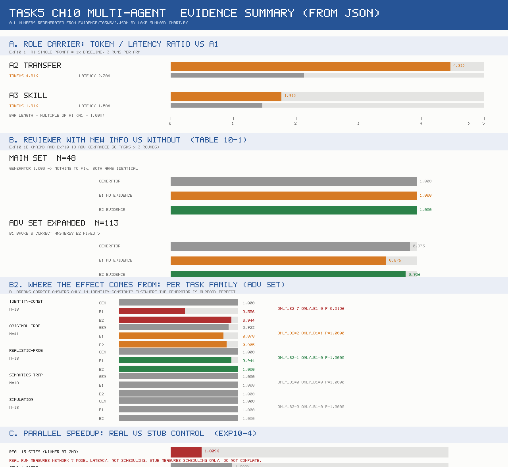

# AI Agent：从入门到工程实践

学习主线：**Agent = LLM + Context + Tools**。

- 课程资料：[bojieli/ai-agent-book](https://github.com/bojieli/ai-agent-book)
- 打卡平台：[Datawhale 活动 77](https://www.datawhale.cn/activity/77)
- 学习周期：活动通知为 10 月 12 日至 10 月 30 日；具体任务截止时间以活动公告为准。

## 笔记索引

| Task | 内容 | 状态 |
|---|---|---|
| [Task0](notes/task00-agent-basics-and-environment.md) | Agent 基础、环境准备、官方离线演示、MiMo 上下文对照 | 已记录实跑结果 |
| [Task1](notes/task01-context-engineering-reflection.md) | Chapter 2：上下文工程 | 学习心得、注意力图、六组提示消融与资料快照压缩实验 |
| [Task2](notes/task02-memory-rag/Task2_十二项实验机制总览.md) | Chapter 3：用户记忆与 RAG | 十二项机制学习与等价实验；[全量记忆验收说明](notes/task02-memory-rag/从238到240_全量验收补充报告.md)：原配置238/240，恢复后240/240 |
| [Task3](notes/task03-tools-and-mcp.md) | Chapter 4：Tools 与 MCP | 工具分类、MCP 接口与执行工具实测；已注明未验证范围 |
| [Task4](notes/task04-coding-agent-and-general-agent.md) | Chapter 5：Coding Agent 与通用 Agent | 闭环、Harness 与代码元能力图解；折扣校验和销售报告两个相关实验及复现代码 |
| [Task5](notes/task05-ch10-multi-agent.md) | Chapter 10：Multi-Agent 协作 | [概念笔记](notes/task05-ch10-multi-agent.md) + [实践记录](notes/task05-ch10-practice.md)：角色载体对照、审查证据对照、并行编排与级联终止三组实验；[上游源码核对](notes/task05-ch10-upstream-map.md)。含负结果与未完成项 |

## 目录

- `notes/`：学习笔记与实验分析。
- `code/task0/`：课程原始 Agent 的 MiMo 提供商适配入口。
- `evidence/task0/`：真实截图、对照汇总和从运行记录提取的证据。
- `code/task5/`：Chapter 10 实验代码（`agents_core.py`、`exp_a_context_modes.py`、`exp_b_verify_evidence.py`、`parallel_web_research/`）。
- `evidence/task5/`：Chapter 10 原始证据（JSON/JSONL、pytest 输出、一页纸对照图）。
- `_upstream/`：Chapter 10 上游源码快照（固定 commit `dbc046e`），仅用于机制核对，未端到端运行。

## Task5 一页纸

由 `evidence/task5/make_summary_chart.py` 从 evidence JSON 直接生成，改证据后重跑即可更新。

Task2阅读入口：[十二项机制总览](notes/task02-memory-rag/Task2_十二项实验机制总览.md) · [基础科普报告](notes/task02-memory-rag/从记忆到证据.md)。机制运行完成不等于官方十二项原样全量验收或所有回答通过。

Task5 记录了三组本地实验与一次上游源码核对，全部由本机 8789 端口的 Responses API 代理真实调用完成。需要提前说明的边界：

- 实验 10-2（书籍翻译管理者模式）与 10-6（语音狼人杀）**未运行**：前者需要大量真实翻译调用，后者依赖 ASR/TTS 音频链路，本机不具备。
- 实验 10-4 的完整 `--mode full` 正式运行**未跑完**（一次 15 路合并运行 60+ 分钟未收尾，远程模型端点偶发 502）。交付用的是可复核的 run1 + 两次级联 + 纯调度桩对照。
- **实验 10-4 的加速比不可当作性能结论**：真实条件下只测到 1.009x（串行第 2 个站点就命中并提前停止，且延迟大头是远程模型调用而非抓取）；桩对照的 8.003x 只证明调度器本身正确。真实站点直连（L1）跑了两次，并行**反而更慢**（0.6x 与 0.103x），4 路因 403/超时被隔离，上下文 8/8 全部关闭。
- **实验 B（表 10-1）的显著差异集中在一个小任务族**：补足样本到 113 对后 p=0.0117，但主导机制是 B1 把 8 个正确答案改错（identity-constant 族，18 对），不是 B2 修正错误；且 B2 的正确率有"照抄执行结果"的成分。详见 [实践记录](notes/task05-ch10-practice.md) §2.4。
- KV Cache 命中率**无法测量**（本机代理 `cached_tokens` 恒为 0），A2/A3 的成本差异只有结构证据。
