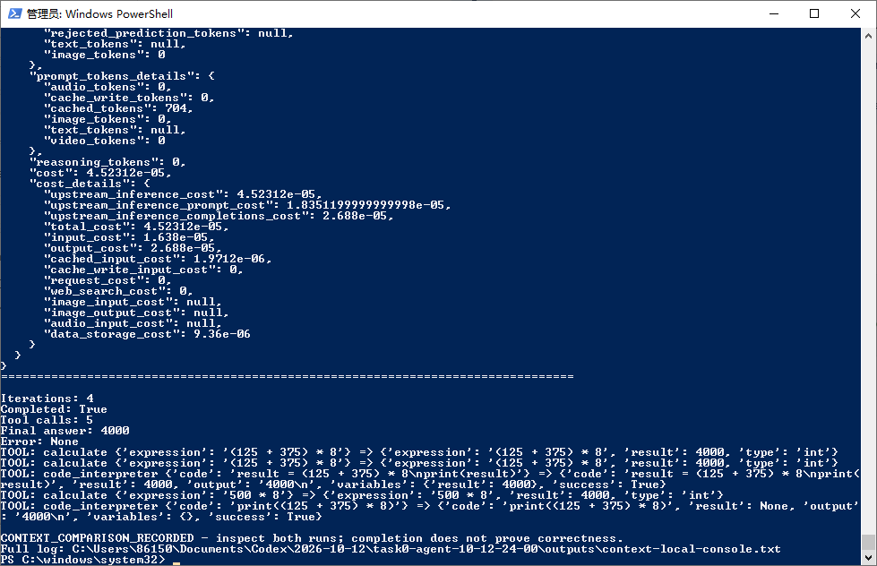

# Task 0：Agent 基础与环境准备

> 学习日期：2026-10-12。课程：ai-agent-book，Chapter 1。
> 实验环境：官方离线演示在 vm-60 / Python 3.10.12；真实 API 和上下文对照在 Windows / Python 3.10.2。
> 模型：AMD Radeon 接口提供的 MiMo-V2.6-Flash。对照实验使用课程原始 `ContextAwareAgent`，只新增提供商适配。

## 1. 本次完成了什么

Task0 的目标是理解 AI Agent，配置实验环境，并提交运行截图与 100 字以上学习笔记。本次完成了三项可以分开验证的工作：

| 项目 | 结果 | 能证明什么 |
|---|---|---|
| `web-search-agent` 官方离线演示 | 正常输出两轮示例搜索轨迹及最终答案，SSH 退出码 0 | 课程代码能运行，能观察 Agent 循环的结构 |
| MiMo API 连通验证 | `/models` 与 `/chat/completions` 均返回 HTTP 200，回复 `API_OK` | 指定模型接口可以真实调用 |
| `context` 两组对照 | full 与 no_tool_results 均结束，最终答案均为 4000 | 可以比较工具反馈对本次执行过程的影响 |


## 2. Agent = LLM + Context + Tools

可以把本次实验中的分工理解为：LLM 根据目标与当前信息选择下一步，程序执行工具，把工具结果追加到上下文，再让模型继续处理。

| 组成 | 本次实验中的对应内容 |
|---|---|
| LLM | MiMo-V2.6-Flash，选择工具、生成参数和最终回答 |
| Context | 系统要求、用户问题、工具定义、历史调用，以及返回给模型的工具消息 |
| Tools | 课程的 `calculate`、`code_interpreter` 等本地 Python 工具 |

模型返回工具名和参数，并不表示工具已经执行；工具由程序实际执行。工具在本地算出结果，也不表示模型一定读到了结果，还要检查下一轮请求中是否携带它。

以计算任务为例，执行循环是：

```text
用户提出任务
  → 模型选择 calculate 并返回参数
  → 本地 Python 执行计算
  → 程序追加 role=tool 消息
  → 模型读取更新后的上下文并回答，或继续调用工具
```

## 3. 官方离线演示：先看清流程

在课程仓库的 `chapter1/web-search-agent` 目录运行：

```bash
python main.py --provider offline-demo --output demo.json
```

示例问题是“Moonshot AI 的 Context Caching 是什么技术？”。轨迹先搜索定义，再搜索用途，最后整合回答。这条轨迹适合观察行动与反馈的关系，但其中标为“思考”的文字也是示例内容，不是本次真实模型推理。

这一步在 vm-60 成功执行。后续取回文件曾发生 SCP 路径错误，运行成功与文件传输成功需要分别判断。本目录保留的是成功终端日志的节选，不把它伪装成已经取回的远端 JSON。

## 4. Context 对照：答案相同，过程不同

固定任务：**请调用计算器计算 `(125 + 375) * 8`，并给出结果。**

两组使用同一模型、相同任务和最多 5 轮的限制，每组运行一次。保留课程原始上下文处理逻辑：full 正常回传工具结果；no_tool_results 在程序中执行工具，但发给模型的工具消息内容为空字符串。

| 模式 | 运行轮数 | 工具调用次数 | 最终回答 | 运行错误 |
|---|---:|---:|---|---|
| full | 2 | 1 | 4000 | 无 |
| no_tool_results | 4 | 5 | 4000 | 无 |

full 只调用一次 `calculate`。隐藏结果组反复调用计算器，并尝试 `code_interpreter`，包括将原表达式改写为 `500 * 8`。

检查真实请求记录后可以确认：full 第二轮的工具消息包含 `result: 4000`；隐藏组后续请求的所有工具消息均为空。因此这次差异不是仅切换了一个名称，工具结果确实没有回传给隐藏组。



截图展示隐藏组的结束输出；两组对照数据以 [summary.json](../evidence/task0/summary.json) 为准，请求中工具消息的核对依据见 [full.json](../evidence/task0/full.json) 和 [no_tool_results.json](../evidence/task0/no_tool_results.json)。这些 JSON 是从实际保存的运行记录提取的证据，不是重新运行或人工构造的实验结果。

## 5. 学习理解：最终答案正确还不够

本次最值得记录的是，两组最后都答对了，但隐藏反馈后工具调用从一次增加到五次。只看最终的“4000”，会漏掉模型重复计算和尝试其他工具的过程。Context 因此不是附加的聊天记录，而是模型判断“已经做过什么、刚才得到了什么”的依据。程序保存了结果与模型实际收到结果也必须区分：隐藏组的本地记录里有 4000，不代表它能依据这条工具反馈作答。

不过，这道题本身很简单，模型可能自行算出正确答案。此次结果只能说明，在这一次运行中，隐藏反馈伴随更多轮次与工具调用；不能推出缺少反馈一定答错，也不能把调用次数直接当成实测延迟或费用。后续应换成必须依赖外部观测的任务，并重复运行，才能讨论更稳定的影响。

## 6. 环境配置中遇到的问题

| 问题 | 处理与认识 |
|---|---|
| Windows PowerShell 正常 stderr 输出被当成异常 | Git 克隆进度写入 stderr；脚本应依据退出码判断结果 |
| vm-60 缺少 ensurepip | 在独立虚拟环境中安装 pip 后继续，没有把依赖装进系统 Python |
| 仓库检出后缺少预期目录 | 检查仓库状态并恢复对应目录后，再运行官方入口 |
| Windows pip 报 `check_hostname requires server_hostname` | 定位到系统代理；仅为安装/实验子进程绕过代理，未修改系统代理配置 |
| 密钥在沙箱中无法解密 | 使用本人桌面 PowerShell 读取 Windows 加密凭据，启动真实请求；密钥未放入仓库 |

API 连通、Python 依赖安装、工具执行和结果文件传输是不同环节。某个环节失败，需要检查具体日志，不能一概归因于模型。

## 7. 扩展：从本次 Codex 使用看 Agent 产品

本次用 Codex 辅助下载代码、分析报错和整理实验结果，可以按同一个框架分析：

| 组成 | Codex 在本次任务中的表现 |
|---|---|
| LLM | 理解课程要求，分析代码和运行日志，选择后续操作 |
| Context | 对话中的任务要求、课程文档、源码、终端输出、运行结果与截图 |
| Tools | 文件读写、终端命令、网页读取等本会话实际可用的工具 |

实际操作还受到权限边界影响。例如 Codex 能生成脚本，却无法直接使用桌面会话加密的凭据；这一步由本人启动脚本完成。这提醒我，讨论 Agent 的能力时，需要同时看可用工具、工具权限和反馈链路。

## 8. 复现与范围

本目录的 [MiMo 适配脚本](../code/task0/run_context_mimo.py) 使用环境变量 `AMD_API_KEY`，通过 `AI_AGENT_BOOK_DIR` 指向单独克隆的课程仓库。步骤见 [代码说明](../code/task0/README.md)。脚本使用课程原始 Agent 类
## 资料来源

- [ai-agent-book 课程仓库](https://github.com/bojieli/ai-agent-book)
- [Chapter 1 正文](https://github.com/bojieli/ai-agent-book/blob/main/book/chapter1.md)
- [Chapter 1 实验目录](https://github.com/bojieli/ai-agent-book/tree/main/chapter1)
- [web-search-agent 实验说明](https://github.com/bojieli/ai-agent-book/tree/main/chapter1/web-search-agent)
- [context 上下文实验说明](https://github.com/bojieli/ai-agent-book/tree/main/chapter1/context)
- [AMD Radeon API 入口](https://developer.amd.com.cn/radeon/api/v1)

本笔记由 Codex 辅助整理，结果来自本人实际运行与提供的截图；分析只针对本次两组运行。
