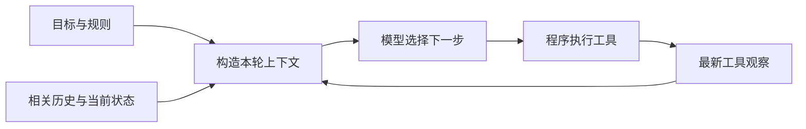
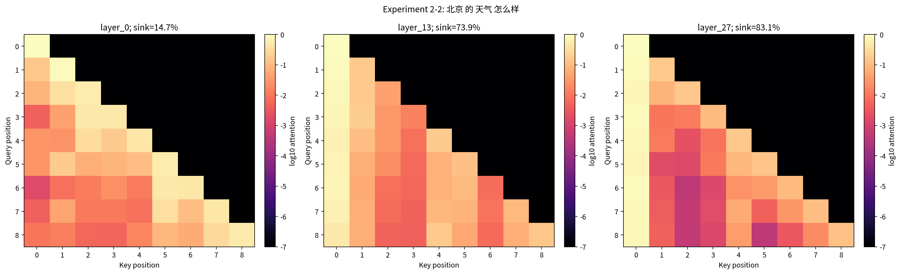

# Task1｜上下文工程：让 Agent 看见下一步所需的信息

> 课程⑧ · Chapter 2：Context Engineering  
> 学习时间：2026 年 10 月 12—14 日  
> 实验：本地 Qwen3-0.6B + RTX 4090 D；API 对照采用 MiMo-V2.6-Flash。

## 1．计算器已经算出了 4000，为什么还要再算？

想象这样一幕：你请一位助手计算 `(125 + 375) × 8`。他把纸条交给计算器，计算器写下 **4000**，但纸条被留在另一个房间。助手回来后看见的只有原来的问题。

此时，计算器的工作已经完成，而助手手中的信息尚未更新。他可能再问一次计算器。

这正是我从上一章带进本章的问题。真实 API 对照中，正常回传工具结果的一组用了 **2 轮、1 次工具调用**；把工具结果隐藏后，另一组用了 **4 轮、5 次工具调用**。最终答案都是 4000，但到达答案的路径明显不同。

这道简单算术题把一个容易忽略的边界照亮了：**程序知道的事情，只有进入下一轮模型输入，才成为模型能直接依据的信息。**

工具像伸向外部世界的手。上下文则把行动结果带回眼前。手完成了动作，眼前的画面也要随之更新。

## 2．Prompt 是任务卡，Context 是整张工作台

“修复登录失败”是一张任务卡。真正动手时，工作台上还需要报错、源码、项目规范、测试结果，以及已经尝试过的修改。

在本章的教学语境里，我把 **Prompt** 理解为要求模型做什么的指令，把 **Context** 理解为本轮模型实际收到的全部信息。前者是后者的一部分；工程交流中的 prompt 有时也泛指整个输入。

| 工作台上的内容 | Agent 中的对应物 |
|---|---|
| 工作规则 | 系统指令、业务约束 |
| 当前任务卡 | 用户请求 |
| 工具使用说明 | 工具名称、描述、参数 schema |
| 操作记录 | 历史回复与工具调用请求 |
| 刚送回来的观察 | 工具结果、测试输出、检索资料 |

把视角拉到某一步决策，整个过程就变成：



记第 $t$ 轮的上下文为 $C_t$、行动为 $A_t$、新观察为 $O_{t+1}$，用 $B$ 表示上下文构造函数，可以写成一个示意模型：

$$
A_t \sim p_\theta(A\mid C_t),\qquad
C_{t+1}=B(G,H_t,A_t,O_{t+1}).
$$

模型参数 $\theta$ 描述它的通用能力，$C_t$ 则决定这一次可以依据什么作判断。**上下文工程主要设计的，就是这个 Build：选择、组织、更新，并在容量约束下保存关键事实。**

一个细节让我对 Agent 的理解变得具体：常见的消息接口里，工具说明通过 `tools` 字段传入，工具观察通过 `tool` 消息返回；模型提出的调用请求还要由程序实际执行。名称、参数、执行和反馈是四个相连的环节。

## 3．工作台有边界：Context Window 与 Token

现在把工作台画成一条有固定长度的横条：

```text
┌──────────┬─────────┬──────────┬────────────┬───────────┐
│ 规则工具 │ 当前任务│ 相关资料 │ 历史与状态 │ 预留输出  │
└──────────┴─────────┴──────────┴────────────┴───────────┘
                         有限的上下文窗口
```

模型按 **token** 处理输入。Token 是 tokenizer 切分后的单位，一个汉字、一个单词、一个数字串都可能被拆成不同数量的 token。因此，文件的字符数和模型的输入长度需要分开计量。

在输入与输出共享窗口的简化模型里：

$$
T_{\text{input}}+T_{\text{output}}\leq W.
$$

若教学示例中的窗口是 32,000 token，预留输出 4,000、余量 2,000，那么输入预算约为 **26,000 token**。再分给规则和工具 3,000、当前任务 1,000，留给资料与历史的约为 **22,000 token**。实际服务还可能设置独立的输入、输出及推理预算限制。

这让我意识到，上传了一个文件，并不等于它的每一段都值得一直摆在工作台上。容量管理开始于两个问题：**下一步需要什么？哪些信息可以在需要时重新读取？**

## 4．先观察模型如何“读”，再讨论怎样摆放资料

实验 2-1 把模型真正运行起来：在 vm-60 的 RTX 4090 D 上启动 Ollama 和 Qwen3-0.6B，让模型查询上海与 Denver 的时间。模型给出工具调用，程序获得两个时区的结果，再把结果送回模型生成回答。

这个小任务让我看见了完整的信息回路。三次短输出服务基准中，平均解码速度约 **502 token/s**；基准输出上限为 128 token。它测量的是这一设置下的生成速度。

接着，实验 2-2 把“读取上下文”展开成矩阵。下面三幅图来自同一输入“北京 的 天气 怎么样”，分别取第 0、13、27 层，并对注意力头取平均：



读图时，我先找行和列：**行是正在计算的位置，列是它读取的位置。** 上三角是黑色，反映因果遮罩：当前位置只能读取自己和前面的位置。再看左边第一列，越往深层越亮；这次输入中，首 token 获得的平均注意力在三层分别约为 **14.7%、73.9%、83.1%**。

抽象的“上下文”于是变成了可以测量的 token 间权重。这里的亮度表示所选层、所选统计口径下的注意力分配；判断一段资料对答案的作用，还要结合模型输出和对照实验。

## 5．整理工作台：选择、组织与管理

### 选择：把下一步需要的材料放到眼前

如果任务要求“金额使用人民币”，这条约束会影响最终答案。重复的连接成功日志可以合并成一句，而金额、单位、关键错误和来源值得保留。

我的选择标准逐渐变成：**保留能改变下一步判断的信息。** 信息是否相关、是否可靠、是否仍适用，比它有多长、出现了多少次更有意义。

### 组织：让事实之间的关系显露出来

实验 2-4 使用 Tau-Bench 航空客服任务。客服 Agent 读系统业务规则与工具说明，通过多轮问答和工具操作处理订单；另一个模型模拟客户，评分由业务环境检查最终状态。

六组使用相同十个任务，每个条件运行一次：

| 组别 | 改变的内容 | 本次业务任务成功 |
|---|---|---:|
| 基准 | 原始业务规则、完整工具描述 | 8/10 |
| Trump 风格 | 在原规则前加入夸张、自信的表达要求 | 8/10 |
| 随意风格 | 在原规则前加入口语、表情等要求 | 8/10 |
| 规则打乱 | 改变规则的组织方式 | 5/10 |
| 删除工具描述 | 清空工具及参数的解释文字，保留结构 | 6/10 |
| 全部叠加 | 随意风格、规则打乱、描述删除一起使用 | 5/10 |

这里最吸引我的对比是：表达风格变化的两组与基准同为 8/10，而规则打乱和描述删除分别为 5/10、6/10。对于这十个任务，**业务规则怎样组织、工具含义怎样解释，与完成情况有直接可观察的联系。**

“先核实身份，再处理退款”包含一个顺序关系；工具参数描述里也可能藏着单位、适用条件和取值含义。组织上下文，就是把这些关系表达清楚，让模型能够据此行动。这些比例描述的是本次十任务样本。

### 管理：把原始流水账变成可接续的状态

实验 2-3 比较六种上下文处理：稳定前缀、动态系统提示词、动态用户配置、工具顺序变化、滑动历史窗口、纯文本消息拼接。它让我同时关注两件事：模型读到了什么，以及哪些前缀计算可以复用。

稳定前缀有利于服务端复用缓存；如果每轮都把变化的时间戳塞到系统提示词开头，后面的长前缀也可能需要重新计算。因而动态状态放在哪里，也是上下文工程的一部分。

实验 2-8 和 2-9 则把进度显式写出来。与其每轮让模型重数电话日志，不如提供一条状态：

```text
当前目标：处理 Xfinity 退款
已调用：phone_call 3 次
约束：每家公司最多调用 3 次
当前进度：已达到电话次数上限，选择其他推进方式
```

2-8 的两组各生成三次：加入状态栏的一组三次都明确拒绝继续拨打，普通轨迹组有两次明确拒绝、一次其他回应。2-9 进一步比较时间戳、计数器、TODO、详细错误、系统状态及组合配置。

对我来说，这些技术的共同作用是：**把分散的经历整理成下一步可以直接使用的状态。** “已经做过哪些事”之后，还应接上“结果是什么、当前判断是什么”。

## 6．把资料压短：我们究竟希望保留什么？

“计算完成”和“已计算 `(125+375)×8`，结果为 4000”，都很短，但它们支持的下一步行动不同。前一句保留了进度，后一句同时保留了对象和结果。

这给上下文压缩提出了一个目标：**用更短的表示，保存当前任务需要的事实与关系。**

本次 2-10 使用固定版本的真实课程源码、配置和说明，构成相同资料快照。六种处理方式分别是：

| 策略 | 压缩的直觉 |
|---|---|
| 无压缩 | 保留全部原文，建立参照 |
| 逐条摘要 | 每份资料先各自总结，再汇合 |
| 合并摘要 | 把多份资料一起总结，消除跨文档重复 |
| 任务感知摘要 | 根据当前问题决定保留重点 |
| 带引用的任务感知摘要 | 同时保存事实与来源的联系 |
| 窗口式历史压缩 | 压缩旧观察，保留最新观察原文 |

随后，向模型询问同样的五项事实：KV 模式、上下文预算、攻击渠道数、防御条件数和每格重复次数。

无压缩输入约 **14,897 个 cl100k token**，五项回答全部匹配；任务感知摘要保留 **314 token**，五项也全部匹配。以这次一致计数的口径：

$$
\frac{T_{\text{保留}}}{T_{\text{原始}}}
=\frac{314}{14897}\approx 2.11\%.
$$

只留下约 2.11% 的长度，仍然保存了这五个问题所需的信息。带引用的任务感知摘要保留 633 token，同样得到 5/5。这里的 cl100k 用于统一比较文本长度，接口返回的模型 token usage 另行记录。

我喜欢用一个画面理解这个结果：整份资料像铺开的城市地图，而当前问题是一条具体路线。任务感知摘要把这条路线需要的路口、方向和目的地留下来。换一个目的地，就应重新检查摘要里留下的路标是否足够。

**长上下文**扩大工作台，允许更多原文进入；**按需检索**在需要时取回资料；**压缩**让已有信息更紧凑。三者可以合作。关键数字、单位、否定条件、决定和证据位置，是我会优先检查的内容。

还有一个技术区分：上下文压缩改变送入模型的内容；**KV Cache** 复用已有前缀的计算状态。摘要解决表示长度，缓存解决计算复用，它们在不同层面发挥作用。

## 7．来源也属于上下文的含义

实验 2-5 采用三种攻击渠道——直接消息、网页内容、跨会话记忆——配合四层防御，各重复五次，共 60 个条件。

这个实验把“资料来自哪里”变成了具体问题。用户要求总结一个网页，网页里的文字即使写成命令，也仍然是被阅读的内容。系统规则、用户任务和外部资料各有自己的来源与权限含义。

因此，组织上下文时，我会同时保存**内容和身份**：这是一条用户要求，还是一个网页片段？这是工具返回的观测，还是已经确认的操作授权？来源标记帮助模型理解边界，执行程序的权限校验负责落实边界。

选择资料时问“这条信息有用吗”，还应接着问“它能作为哪一种依据”。

## 8．本次学习心得：从一次回答，走向持续行动

学习这一章之前，我更容易把 Agent 的表现归结到模型大小或提示词写法。经过工具反馈、注意力、提示消融、状态栏和压缩实验，我开始把注意力放到每个决策点：**此刻的上下文是否足以支持正确的下一步？**

一个可以接续工作的 Agent，需要知道目标、约束、已做动作、已得结果和当前状态。随着任务推进，原始记录会增长，状态会变化，旧结论也需要更新。上下文工程于是成为持续的信息组织工作。

对我最有用的一份最小记录是：

```text
目标：要完成什么
约束：必须遵守什么
已做：采取了哪些动作
证据：得到了什么结果，原文在哪里
状态：哪些结论已确认，还需要解决什么
下一步：基于上述信息继续行动
```

现在再看 **Agent = LLM + Context + Tools**，我会把它读成一条运转的回路：模型根据眼前的信息选择行动，工具带来新的观察，上下文工程把这些观察整理成可以继续工作的依据。

那张写着 4000 的纸条，终于被送回了工作台。

---

### 资料与实验依据

- [课程 Chapter 2：上下文工程](https://github.com/bojieli/ai-agent-book/blob/main/book/chapter2.md)
- [Chapter 2 实验项目](https://github.com/bojieli/ai-agent-book/tree/main/chapter2)
- [上一章真实工具反馈对照](task00-agent-basics-and-environment.md)
- [2-1 本地服务测试](../evidence/task1/exp2-1/exp2-1-throughput.json)
- [2-2 注意力验收与矩阵](../evidence/task1/exp2-2/manifest.json)
- [2-4 六组消融汇总](../evidence/task1/exp2-4/ablation_summary_1014050317.json)
- [2-5 攻防条件汇总](../evidence/task1/exp2-5/exp2-5-adapted-comparison.json)
- [2-8 状态栏与注意力对照](../evidence/task1/exp2-8/comparison.json)
- [2-9 状态提示条件汇总](../evidence/task1/exp2-9/comparison.json)
- [2-10 六策略资料快照对照](../evidence/task1/exp2-10-snapshot/comparison.json)

本文由本人学习讨论与实跑记录整理，Codex 辅助写作；实验源码版本为 `dbc046eb896ac4e39aa19c7774c8bf49583b89a6`。API 实验使用 MiMo 适配，本地注意力使用 Qwen3-0.6B；压缩部分采用固定资料快照机制对照。
