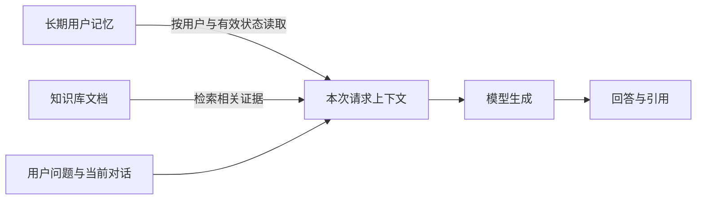
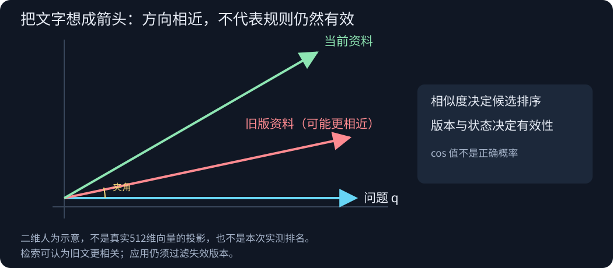
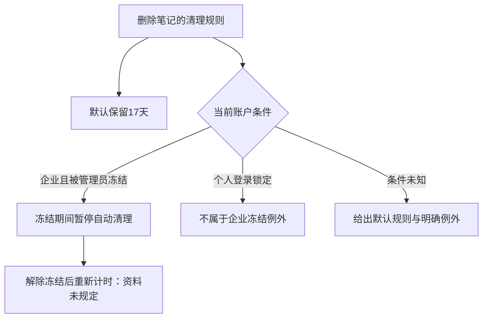
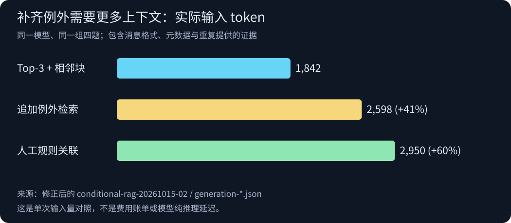

# 让模型看见正确的信息

## 从用户记忆到 RAG 的一条推导路线

> 本文先建立直觉，再引入概念与实验。所有产品规则均为虚构教学数据；实验实际运行于 vm-60，使用真实 BGE Embedding 与 AMD 模型 API。文中的二维箭头只是几何示意，实验中的向量为512维。

### 1. 先把模型想成一张有限的工作台

想象你把一个问题放在工作台中央。旁边摆着几张纸：当前对话、用户偏好、从资料库找到的段落。模型需要根据眼前这些内容写出回答。

昨天的纸即使已经归档，也不会自动出现在今天的桌面上。这就是理解用户记忆的起点：**信息被保存，与它参与本次回答，是两件事。**

当然真实世界的大模型和这个比喻并非百分之百一致。大模型在训练中已经学到大量一般规律，并非只知道桌上的内容；但对本实验里的虚构产品规则和新用户偏好，模型自然事先不知道。应用必须把这些信息带进当前请求。



短期记忆可以先理解为当前任务或会话可用的状态；其中送进模型的部分形成当前上下文。长期记忆则跨越会话保存在外部系统中，在需要时重新读入。两者的边界取决于应用如何管理状态，不能仅按“有没有文件”判断。

这张工作台图景马上给出三个检查点：纸有没有归档？今天有没有取出来？写回答时有没有按它办？

### 2. 记忆是一条会变化的记录

我们先让虚拟用户说：

> 解释技术概念时，请先用养蜂作比喻。今天我只有十分钟。

这句话包含两种时间尺度。教学偏好可能在未来多次会话中有用；十分钟则只约束今天。于是，写入记忆并不是把整段聊天原样复制，而是选择值得保留的事实，同时保留其来源和适用范围。

实际实验中，模型提取出养蜂偏好，程序保存到 JSON 文件。随后启动新 Python 进程，问“什么是 Embedding？”：不读取记忆时，回答直接解释向量；读入记忆时，回答使用了蜜蜂与气味坐标的比喻。

独立进程让这个实验更容易解释：后一次调用不能依赖前一个进程的内存，必须经过磁盘读取。但它仍然只是小规模机制验证，不足以证明所有回答都会稳定遵从偏好。

接下来，用户说“以后改用做饭作比喻”。如果只把新句子追加进去，存储中就会出现两个都很相关、却不能同时作为当前偏好的记录。

解决办法是给记录加入状态：

```text
历史记录 m1：养蜂比喻  → superseded，被 m2 替代
当前记录 m2：做饭比喻 → active
```

读回答用的记忆时，只取当前有效记录；需要追溯变化时，再查看历史。实际新回答改用了食材与调料架的比喻，六项存储与读取机制检查全部通过。

这里出现第一个重要区分：**相关性是一种几何关系，有效性是一种状态关系。** 旧偏好可以非常相关，同时已经失效。

### 3. 把文字变成箭头

现在把工作台旁边的资料柜放大：里面有几千篇文档。每次都全部搬上桌，既浪费上下文，也增加噪声。我们需要一种方法，先找出可能有用的部分。

Embedding 的做法，是让一个训练好的编码器把文字变成向量：

```text
编码器 f：一段文字 → [x₁, x₂, …, x₅₁₂]
```

先暂时忘掉512维，想象二维平面上的箭头。一个箭头代表问题，其他箭头代表文档片段。检索模型经过训练，希望相关问题与证据在这个空间里具有可用于排序的关系。

这不是按人类手工定义的“主题轴、时间轴”打坐标。每个维度通常没有这样直接的解释，模型也不能保证所有语义关系都被准确编码。二维图只是帮助理解相似度计算，不是对真实512维向量的投影。



对于两个向量，余弦相似度比较它们的方向：

```text
cos(q, d) = (q · d) / (‖q‖ × ‖d‖)
```

把向量长度都缩放到1，分母就变成1，此时只需计算点积。我们的真实实验采用 CLS 表示、L2归一化，再精确计算查询与所有片段的点积，排序取前几名。没有使用近似搜索或独立向量数据库服务。

**箭头更靠近问题，意味着检索模型认为它更相关，不意味着这条信息正确、最新或适用。** 余弦值也不是答案正确的概率。

这解释了一个看似矛盾的结果：旧版“保留30天”与新版“保留17天”都可能排名很高，因为它们讨论的主题几乎一样。版本状态应通过元数据或规则处理，不能期待相似度替我们裁决。

### 4. 关键词检索与向量检索，是两种不同的线索

关键词检索追踪文字重合：错误码 NX-418 就是一个非常明确的线索。BM25 会综合词在片段中的出现次数、在整个语料中的稀有程度，以及片段长度，给候选片段打分。

向量检索追踪编码器学到的关联：“断网后修改怎么办”可能与“离线编辑进入待发送队列”相关，即使措辞不完全相同。

两者没有不依赖任务的胜负关系。我们实现了透明的中文字符二元组加完整英文词元 BM25，并与真实向量检索比较。在这个小型语料里，三道有答案的问题，两种方法都把正确文档排在第一位。**本实验没有证明向量检索优于关键词检索。**

还有一个更隐蔽的事实：即使知识库没有答案，排序算法依然通常能给出 Top-k。

问“学生订阅优惠是多少”时，系统仍会找出几个相关程度最高的片段。但“最高”只是候选之间的相对关系，不代表任何片段真的回答了问题。生成阶段实际选择了资料不足，没有编造折扣。

因此，检索解决的是候选选择，充分证据判断仍然需要单独处理。

### 5. 切分不是切小，而是选择每次能看见多大范围

设想一篇说明文档被切成若干窗口。窗口越小，主题可能越集中；但一条规则的数字、条件或例外也越容易落在窗口之外。

我们把同一批文档分别切为60字和120字片段，都重叠20字。对“断网后如何处理、最多重试几轮”的问题，60字向量检索实际取回：

```text
片段1：本机待发送队列 → 联网后自动上传 → ……自动重
片段2：另一篇回收站旧版规则

未取回的后续内容：……最多尝试七轮……
```

正确文档已经命中，但回答所需的数字没有进入最终上下文。换成120字片段后，“最多七轮”进入了检索证据。

如果只检查“有没有命中正确文档”，两种设置都可以拿到满分。我们的三道可回答问题，文档级 Hit@1 都是100%；但60字向量组的关键证据短语覆盖只有2/3，120字为3/3。短语覆盖同样只是一个有限指标，不能代替完整语义判断。

补跑60字片段问答时，模型说明了本地排队和联网上传，但表示重试轮数资料不足，没有凭空补出七轮。它还出现了一处过度拒答：已经知道联网后自动上传，却又笼统说恢复后的具体处理不足。这提醒我们，拒答本身也需要检查范围。

这里的修复应该针对失败位置：正确文档没进候选，才优先考虑召回；正确文档进来了但条件被切走，则可以考虑相邻扩展、父块或结构化切分。单纯增加 Top-k 可能增加噪声，而不一定补齐需要的细节。

### 6. 从找一段话，到找一组共同成立的规则

现在让问题再向前走一步。默认规则写在回收站章节：

> 删除的笔记默认保留17天。

另一个章节写着：

> 企业账户被管理员冻结期间，暂停回收站自动清理。

即使第一段被完整取回，回答仍然可能不完整。因为这一次缺失的内容不在附近，相邻窗口再扩大一点，也跨不到另一章。

我们可以先把规则画成一个分支，而不是一句孤立的结论：



直觉上，“17天”没有突然变成错误事实；真正的问题是，我们把一个带条件的规则，压缩成了一个没有条件的数字。

跨章节实验固定80字块、20字重叠、Top-3，比较三种方法：同源相邻扩展、追加一次例外检索、沿人工规则关联补取资料。模型与生成提示保持相同。

| 需要判断的内容 | 仅相邻扩展 | 追加例外检索 / 人工规则关联 |
|---|---|---|
| 用户账户状态未知 | 知道17天，但说不清具体例外 | 给出默认17天及企业冻结例外 |
| 企业账户被冻结 | 承认冻结影响未知 | 正确回答冻结期间暂停清理 |
| 个人登录锁定 | 不知道锁定是否影响清理 | 区分登录锁定与企业冻结 |
| 解除冻结后的期限 | 单独调用检验 | 明确资料未规定，不编造重新计时 |

这两种扩展使用了额外业务知识：追加查询中的例外关键词是人工选定的，规则关联也是人工编写的。它们展示的是已知业务范围内如何补齐证据，不是系统自动发现所有未知例外。

代价也真实存在。修正后的四题批量请求，输入token从1842增加到2598或2950，分别约增加41%和60%。这些数字包含消息与元数据，也包含每题重复提供的证据；不是每题独立调用成本，更不是严格延迟基准。



在账户状态未知时，资料已经足以覆盖主要分支，可以直接说“通常17天；企业冻结期间暂停清理”。而在解冻重新计时规则缺失时，无论追问多少账户信息，都不能从现有资料推出一个不存在的期限。这是两种不同的不确定性：**不知道用户处于哪个分支，与不知道分支上的规则，不能混为一谈。**

### 7. 引用是一条可核查的边，不是完成证明

把回答中的一个断言想成一个点，把引用片段想成另一个点。引用试图在两者之间画一条“支持”关系。

但程序最容易检查的，只是片段ID是否存在。它还没有检查这条边是否成立，更没有检查整个规则集合是否缺了一条会改变答案的边。

本次三组共12个回答的引用结构检查都通过，基线却仍然缺少冻结条件。这说明至少要分开检查三件事：

| 层次 | 实际要核查的内容 |
|---|---|
| 来源存在 | 引用指向了提供给模型的真实片段 |
| 断言支持 | 片段确实支持这个数字、动作和限定词 |
| 条件适用与规则覆盖 | 规则适用于当前账户，且已知的重要例外没有遗漏 |

我们还保留了一次组合失败：程序确实读入了做饭偏好，模型却没有用做饭比喻、没有按要求引用，还把“不会立即丢弃”说成“不会丢”。后一句尤其值得留意：原文只承诺短时间内的行为，回答却把它扩大成了没有期限的保证。

同样，条件实验中模型把 `applies_if` 统一输出为 `true`。一个布尔值没有列出适用条件，也不能证明适用性已经检查。若要让程序继续处理，必须定义更明确的字段和验证规则。

### 8. 实验本身也需要隔离信息

我们曾把五个问题以及各自不同的证据放进同一个批量请求。随后发现：冻结题的回答，引用了只提供给解冻题的片段。

从应用输入看，那是“别人的题目里的证据”；但从模型输入看，它就在同一张工作台上。实验设计者划出的题目边界，不会自动变成模型看不见的隔板。

因此，第一轮被判为无效对照，停止并保留记录。修正后的前四题在同一组中共享完全相同的证据集合，并通过程序断言；解冻题单独调用，不再把额外例外提前暴露给基线。

这也让最初的工作台比喻闭合起来：**系统行为首先受实际输入的信息边界约束，而不是受我们以为存在的信息边界约束。**

### 9. 用三个问题把整条链路重新串起来

学习过程中提出的诊断框架，可以沿着信息进入工作台的顺序使用：

1. **正确证据进最终上下文了吗？** 检查原文、分块、排序和实际请求。正确文档命中，但关键数字不在请求里，问题仍在检索链路。
2. **相关记忆是否过期、是否与证据冲突、是否被注入？** 核对用户、来源、状态、时间与请求中的实际内容；还要区分“注入上下文”与恶意提示注入，不能把资料当成执行指令。本实验未做提示注入攻击测试。
3. **输出受到哪些证据支持，适用条件是否成立？** 逐条检查断言与引用，检查数字、例外和限定词有没有被改变。若想判断模型真正依赖了哪条信息，还需要移除或替换信息的对照；引用本身不能揭示内部推理过程。本轮未做系统性的因果归因。

用户记忆与知识库在这里有了清晰的位置：前者帮助选择“怎样服务这个用户、哪些个人事实仍有效”，后者提供“这次问题需要哪些外部依据”。它们都通过当前上下文影响回答，也都可能在选择、更新或使用环节出错。

## 实验依据与复现范围

实验日期为2026年10月15日。vm-60上的环境为Python 3.10.12、PyTorch 2.9.1+cu128；Embedding实际在CPU计算。BGE版本为 `7999e1d3359715c523056ef9478215996d62a620`，模型文件哈希保存在原始环境证据中。

| 本文知识点 | 实际证据目录 |
|---|---|
| 用户记忆写入、跨进程读取、更新 | `memory-20261015-05` |
| 真实向量、关键词对照、分块与排名 | `rag-20261015-01` |
| 小分块问答及记忆组合失败 | `rag-followup-20261015-01` |
| 隔离后的跨章节例外对照 | `conditional-rag-20261015-02` |
| 无效跨题对照，留作失败分析 | `conditional-rag-20261015-01` |

以上目录在本报告同级。有效运行的52份证据文件已核验SHA-256；首次跨题泄漏的运行不计入有效对照。原始请求、回答、向量和排名均保留。


教程来源：[《深入理解AI Agent》第3章](https://github.com/bojieli/ai-agent-book/tree/main/chapter3)。编码方法依据：[BGE模型说明](https://huggingface.co/BAAI/bge-small-zh-v1.5)。更详细的执行参数和失败记录见同目录的《RAG实验报告》与《条件适用性实验报告》。
