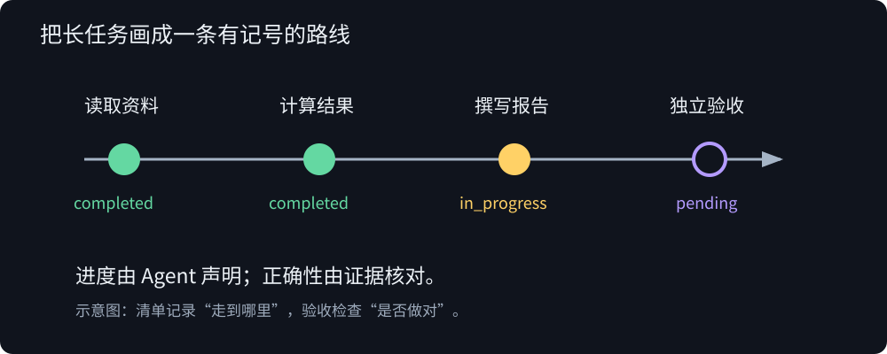
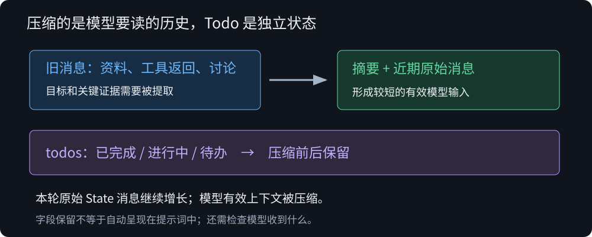
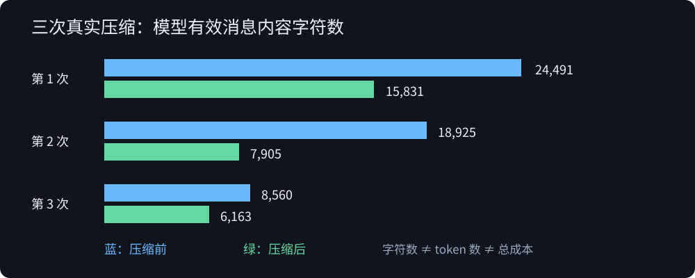

# Agent 为什么做着做着，就忘了自己要做什么？

> Deep Agents · Task3 · 第 4 章：任务规划与分解
>
> 用图像和小实验理解 Todo、中间件与上下文压缩。

想象你在解一道长题。纸上已经写满计算、草稿和参考资料。这时有人问：“你现在做到哪一步了？”

你不缺纸上的信息。你缺的是能把这些信息组织起来的进度线索。

Agent 也有类似的问题。一开始，它知道用户要什么；读过几份资料、调用几次工具之后，眼前的上下文越来越长。它可能再次搜索已经看过的内容，也可能把“写出一份报告”误当成“完成了所有要求”。

这一章要学的，就是怎样让任务的方向和进度变得明确，以及对话变长后，怎样让它们继续发挥作用。

## 1. 从一个循环，看见规划为什么有用

先把 Agent 想成一个反复运行的循环：

```text
观察上下文 → 选择下一步 → 调用工具 → 把结果放回上下文 → 再观察
```

每次工具返回，都会给下一轮增加信息。但“信息更多”不自动等于“全局更清楚”。如果任务需要读资料、计算、比较、写报告、验收，那么当前局部最自然的下一步，未必覆盖用户最初要求的所有步骤。

我们可以在草稿旁边添一张清单，把任务拆成可以核对的动作：



清单给每一步一个位置，还给这个位置一个状态：

```python
{"content": "计算 window=3 和 window=5", "status": "pending"}
```

开始前是 `pending`，执行时是 `in_progress`，做完后是 `completed`。这条路线让 Agent 有机会持续核对：“我已经做了什么，还有什么没做？”

请注意“有机会”这三个字。清单提供了工具和状态，模型是否认真使用，仍然需要观察。

## 2. write_todos：模型把计划写到了哪里？

如果计划只出现在一句普通回答里，它仍然只是消息历史的一部分。后续消息越来越多时，它也会变成需要重新寻找的旧内容。

`TodoListMiddleware` 把规划变成显式能力。它提供三个部分：

| 部分 | 作用 |
| --- | --- |
| `write_todos` | 让模型创建、改写任务清单 |
| State 中的 `todos` | 保存任务内容与状态 |
| 规划指导提示词 | 引导模型何时规划、如何维护清单 |

可以用一个简单的记号来理解更新：

```text
Tₜ = 当前清单
模型调用 write_todos(Tₜ₊₁)
工具执行后，State 保存更新后的清单
```

本次清单更新保留完整列表。它是模型主动写入的进度声明，不是框架自动从实际操作中推导出的进度。

按我们实际运行的 Deep Agents 0.7.8 配置，需要显式加入 Todo：

```python
agent = create_deep_agent(
    model=model,
    tools=tools,
    middleware=[TodoListMiddleware()],
)
```

这也让“中间件”不再那么抽象。不必重写整个 Agent 循环，就能在循环的边界增加指导、工具或状态处理。不同中间件各自处理一部分工作，具体顺序与 Hook 类型有关。

可以想象在循环的两个位置放置观察点：Node-style Hook 在模型前后、Agent 前后运行，适合明确的状态处理；Wrap-style Hook 包住一次模型或工具调用，能够修改请求或处理返回。本次 Todo 的规划指导与 Deep Agents 摘要请求转换都能在模型调用的包装边界观察到。中间件不是另一个替你解题的模型，而是安排这些处理何时发生的机制；摘要处理本身会调用模型。

## 3. 为什么清单全绿了，报告仍可能错？

假设你把“写报告”标记完成。这个标记能证明报告数字正确吗？

不能。因为负责写标记的，正是可能犯错的模型。

我们的第一轮实验清楚地展示了这个差别。Agent 建立了五项计划，确实调用了工具，也写入并读回了报告。最终五项都变成 `completed`，两个窗口的数值也经独立重算正确。

但解释里出现了一句：近期均量“更高”，对应的数值却是 **1600 对 1700**。

如果把两个数放到数轴上，错误立刻显现：1600 在1700左边。工具数值没有错，模型从数值走到语言时，把比较方向写反了。

为什么均量更低，量比却可以更大？把分子和分母一起画进式子就清楚了：

```text
window=3：近期均量 / 基期均量 = 1700 / 1300 ≈ 1.3077
window=5：近期均量 / 基期均量 = 1600 / 1000 = 1.6
```

分子从1700变成1600，分母也从1300变成1000。只盯着近期均量，无法判断比值如何变化。验收解释时，要核对模型是否保留了这种关系。

初版检查脚本只核对解释字段非空，因此先给出通过；后续独立阅读发现了这个错误，最终报告判定不合格。原始检查和复核结论都保留了，见 [基础实验结果](evidence/task3-todo-20261020-181404/result.json) 与 [独立复核](evidence/task3-todo-20261020-181404/review.json)。

这引出两张不同的验收表：

```text
进度验收：有没有读取、计算、写入、核验？
质量验收：数字是否正确、比较是否成立、解释是否有证据？
```

`completed` 回答的是第一类问题中的自报进度，不能替第二类问题签字。我们还观察到，有些任务直接从 `pending` 跳到 `completed`，进一步说明三态流转不是强制执行的状态机。

## 4. 加上 Todo，就一定会出现计划吗？

再做一个思想实验：两名能力相同的解题者，一人拿到清单工具，另一人没有。题目只有几步，而且步骤已经明确写在题面上。前者一定会多写一张计划吗？

未必。他可能直接完成任务。

为了检验这个直觉，我们固定模型、输入、工具与参数，仅改变 Todo 中间件是否启用。两组从独立目录和空消息开始，模型均为 DeepSeek-V4-Flash，temperature=0。共同提示词要求读资料、计算两个窗口、写报告、读回，但不强制调用 `write_todos`。

| 观察项 | Todo 关闭 | Todo 开启 |
| --- | ---: | ---: |
| 机械及数值检查 | 7/7 | 7/7 |
| 工具调用 | 5 | 6 |
| 模型调用 | 4 | 5 |
| `write_todos` 调用 | 0 | 0 |

开启组多了一次目录查询，却没有实际创建清单。两组都完成了计算和文件操作。文字复核中，关闭组把低量基准与收益率解释混在一起，需要修改；开启组本轮通过.

这里学到的是：**让规划能力可用，与让模型实际执行规划，是两个不同的实验变量。**

## 5. 对话越来越长，怎样保留有用的信息？

回到那张写满草稿的纸。你可以继续加纸，但每次都从头阅读，会越来越费力。另一种办法是写一份摘要：记录要解什么、已经得到什么、接下来做什么。

`SummarizationMiddleware` 做的就是这类上下文管理工作。用记号表示：

```text
H = 旧消息 + 近期消息
模型的有效上下文 = summarize(旧消息) + 保留的近期消息
```

摘要试图提取重要信息，因此可能丢失细节，不是可无损还原的文件压缩。摘要本身也需要模型调用。

再把 Todo 放回图里：



摘要负责保存目标、关键证据和继续工作的线索；Todo 用独立字段记录进度；近期消息保留最新工具结果和更新。三者共同帮助 Agent 接着做。

实际版本里还有一个容易误判的细节。Deep Agents 0.7.8 的摘要中间件会构造较短的模型请求，记录 `_summarization_event`，并把旧历史卸载到 Backend。原始 State 消息未必因此变少。

所以，“State 里还有24条消息”与“模型已经用摘要代替旧消息”可以同时成立。观察压缩，要看实际发送给模型的有效消息。

## 6. 让压缩真的发生，再看计划是否还在

为了观察机制，我们没有只安装组件，而是构造了可控负载：两份长资料，每份包含70条明确标注的重复说明。它们增加上下文，不增加价格数据。

这轮明确要求先用 Todo 建立五项计划。摘要阈值设为10条消息，保留最近4条。当前版本已经默认带摘要中间件，因此我们通过同名实例替换配置，并未再叠加一份。

```python
from deepagents.middleware.summarization import SummarizationMiddleware

middleware = [
    SummarizationMiddleware(
        model=model,
        backend=backend,
        trigger=("messages", 10),
        keep=("messages", 4),
    ),
    TodoListMiddleware(),
]
```

实验真实生成了三次摘要：



| 次数 | 有效消息数 | 消息内容字符数 | 当时仍未完成的工作 |
| --- | --- | --- | --- |
| 1 | 11 → 5 | 24,491 → 15,831 | 第二份资料、计算、报告、核验 |
| 2 | 10 → 6 | 18,925 → 7,905 | 计算、报告、核验 |
| 3 | 10 → 5 | 8,560 → 6,163 | 报告、核验 |

每次转换前后，`todos` 内容都相同，而且确实存在未完成项。随后模型继续计算、写报告、读回，最终五项完成。两份资料各读一次；报告的数值和验收标记 `SUMTODO-42` 均正确，九项预设检查通过。

这些证据支持一个有限但具体的结论：**这轮任务在真实压缩后继续执行，没有丢失足以完成任务的目标、数值和进度线索。**

## 7. 摘要和 Todo 不同步时，应该相信谁？

第一次摘要写着：第一项仍是 `in_progress`。但压缩当时的 Todo 已经是：第一项 `completed`，第二项 `in_progress`。

这不一定是摘要模型凭空记错了。它总结的是较早区间，更新的状态仍在保留的近期消息中。

```text
旧区间的摘要：描述过去的进度
近期更新消息：补上后续动作
当前 todos：保存当前显式状态
```

如果只读摘要，就可能重复已经做完的工作。不能把历史摘要当成当前状态的唯一来源。

还有更细的一层：State 中保存 `todos`，不等于模型每轮都自动看见这个字段。我们检查的 Todo 中间件会添加规划指导，但不自动把整个字段逐轮转写为提示词。本次模型继续执行，还依赖摘要和保留消息中的信息。

因此，“Todo 没丢”和“模型能够利用 Todo”应分别观察。如果产品要求每轮明确展示最新清单，就要显式设计这种状态呈现方式。

原始 [上下文快照](evidence/task3-summary-20261020-182551/model_contexts.json)、[模型摘要](evidence/task3-summary-20261020-182551/summaries.json) 和 [最终结果](evidence/task3-summary-20261020-182551/result.json) 可以逐项核对。

## 8. 把学到的东西，变成下一轮实验

现在可以把本章的三个问题分别落到检查上：

| 问题 | 应该看什么 |
| --- | --- |
| Agent 是否有进度参照？ | Todo 工具调用、状态更新与任务覆盖 |
| 长历史是否被有效缩短？ | 真实摘要、模型请求前后消息与历史卸载 |
| 工作是否做对？ | 独立重算、文件读回、文字解释与约束核验 |

下一步需要更长的依赖任务、多次交替运行，以及相同负载下的压缩开关对照。也要统计摘要调用自身的成本：本轮后续摘要正文逐渐变长，说明“已经摘要过”并不代表上下文从此不会增长。

本章真正训练的是一种工程习惯：给进度一个明确表示，给上下文一个管理办法，再给结果一套独立证据。这样我们才能区分“Agent 看起来很忙”“Agent 说自己完成”和“任务确实验收通过”。

## 实验档案与复现

文章中的三轮实验分别保留在 [evidence](evidence/)；运行配置与验收结论以各轮记录为准。

[代码与复现说明](code/README.md) 提供环境变量配置后的便携脚本。

参考：[课程第4章](https://datawhalechina.github.io/deepagents-in-action/chapters/ch04-task-planning/)。本轮安装版本的摘要源码另见 [源码快照](evidence/task3-summary-20261020-182551/installed_summary_source.py)。
