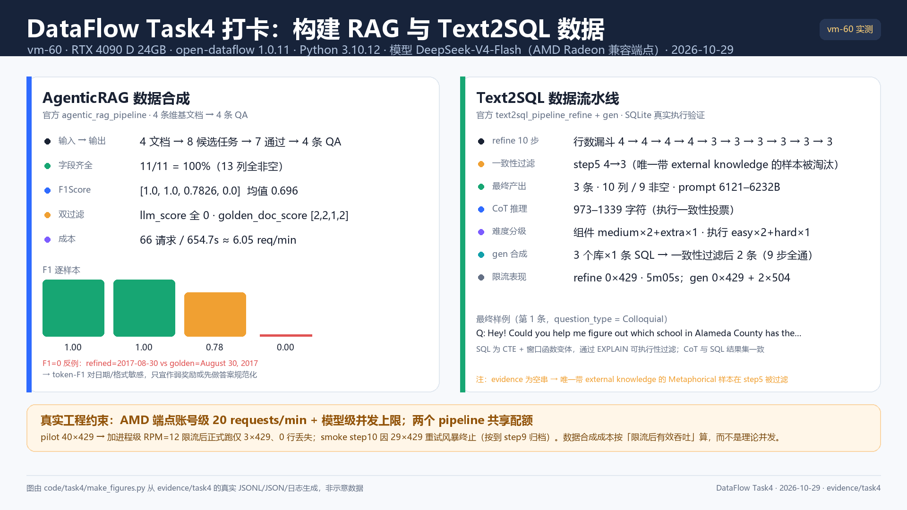

# DataFlow Task4 打卡 · 构建 RAG 与 Text2SQL 数据

> GitHub ID: wsm000 | 微信昵称: empty
> 运行环境: vm-60 · NVIDIA RTX 4090 D (24GB) · Python 3.10.12 · open-dataflow 1.0.11
> 模型: AMD Radeon 兼容端点 DeepSeek-V4-Flash（OpenAI 兼容 /chat/completions）；embedding: 本地 BAAI/bge-small-zh-v1.5
> 数据库: 官方示例库 california_schools / student_club / thrombosis_prediction（SQLite，解压 21MB）
> 教程: [飞书](https://wcny4qa9krto.feishu.cn/wiki/I9tbw2qnBi0lEakmmAGclTysnFd) · [DataFlow 仓库](https://github.com/OpenDCAI/DataFlow) · [AgenticRAG 文档](https://opendcai.github.io/DataFlow-Doc/zh/guide/agenticrag_pipeline/) · [Text2SQL 文档](https://opendcai.github.io/DataFlow-Doc/zh/guide/text2sqlpipeline/)

## 做了什么

把「RAG 数据」与「Text2SQL 数据」两条官方流水线在 vm-60 上真实跑通（真实模型生成、真实 SQLite 库验证），并补了一篇从下游接口反推数据需求的场景分析。算子链本身未改，只改端点、规模参数与本地资产路径。

### 1. AgenticRAG 数据合成（官方 agentic_rag_pipeline，4 条文档 → 4 条 QA）

**输入**：官方示例 `example/AgenticRAGPipeline/eval_test_data.jsonl` 前 4 条 contents（维基段落）。**链路**：`AgenticRAGAtomicTaskGenerator`（identifier → conclusion → question → clean → 无上下文 llm_answer → golden_doc_answer → 两次 recall 判分 → optional_answer，共 8 个 prompt 阶段）→ `AgenticRAGQAF1SampleEvaluator`（refined_answer vs golden_doc_answer 的 token-F1）。

**结果**：输入 4 → 输出 4 行、13 个字段全部非空（含 question / answer / refined_answer / llm_answer / llm_score / golden_doc_answer / golden_doc_score / optional_answer / identifier / candidate_tasks_str / F1Score）。**F1Score = [1.0, 1.0, 0.7826, 0.0]，均值 0.696**；`llm_score` 全为 0（不给文档答不出 → 必须检索），`golden_doc_score` ∈ {1,2}（给文档可答 → grounded），4/4 通过双过滤。成本：66 次 chat 请求 / 654.7 秒（≈6.1 请求/分钟，20 RPM 用户级限流下的真实吞吐）。

### 2. Text2SQL 数据流水线（refine 主链 + gen 合成模式）

**refine（数据优化）**：california_schools 前 4 条 (db_id+question+SQL) 输入。10 步全部跑通：SQLExecutabilityFilter 4→4 → SQLVariationGenerator 4（变体重建行、question 置空）→ 再过滤 4→4 → Text2SQLQuestionGenerator 4（2 候选 + bge embedding 选优）→ Text2SQLCorrespondenceFilter **4→3**（淘汰 1 条不一致）→ PromptGenerator 3（prompt 6121–6232 字符）→ CoTGenerator 3 → CoTVoting 3（cot_reasoning 973–1339 字符）→ SQLComponentClassifier 3（medium/extra/medium）→ SQLExecutionClassifier 3（hard/easy/easy）。**最终 3 行 × 10 列（9/10 列非空，evidence 为空串），5 分 05 秒、0 次 429**（缩采样 + 低并发后）。

**gen（数据合成）**：无输入 SQL，由 `SQLGenerator(generate_num=1)` 对 3 个 SQLite 库各从 Schema 合成 1 条 SQL（sql_complexity_type = Simple/Moderate/Complex 各 1）→ 可执行性过滤 3→3 → 问题生成 3（question_type 各不同）→ 一致性过滤 **3→2**（thrombosis_prediction 那条被淘汰；人工看语义一致，疑似 LLM 一致性判定假阴性）→ prompt/CoT/双难度标签，9 步链路跑通（22:40:37–22:46:19，0 次 429）。

### 3. 不同 AI 应用场景的数据需求

写了 [task04-不同AI应用场景数据需求.md](../../notes/task04-不同AI应用场景数据需求.md)：7 类场景（预训练/SFT/偏好对齐RL/固定RAG/AgenticRAG/Text2SQL/多模态VQA）的数据单元、必需字段、质量门槛、可验证信号、评测指标与 DataFlow 对应 pipeline；含两张字段映射表、跨场景对比表、共同要求×算子映射表、文档vs源码 6 处不一致。核心结论：**数据需求由「下游接口 + 可验证性」决定**，可验证性 Text2SQL(执行) > RLVR(规则) > 固定RAG(证据定位) > AgenticRAG(LLM judge+反事实) > VQA≈偏好对 > 预训练；可验证性越高越敢合成、越敢上规模。

## 环境与真实约束（如实声明）

- **模型接入**：vm-60 无外网直连 OpenAI 等海外 API，改用 AMD Radeon 的 OpenAI 兼容端点（`https://developer.amd.com.cn/radeon/api/v1`）跑 DeepSeek-V4-Flash；key 从远端已有 key 文件读入进程，不落记录。
- **端点限流（本任务最大工程约束）**：该端点对同一用户有 **20 requests/min** 全局限制，且单模型有共享并发上限（实测 GLM-5.3-Flash 报 concurrency limit 32）。两个 pipeline 并发时互相挤占：第一次 AgenticRAG 尝试就因 429 重试耗尽返回 None 导致字段缺失、step2 报错；加进程级 RPM 限速后重跑成功。smoke 的 step10（LLM 最密集的一步）在 29 次 429 后主动终止；正式 run 缩采样 + 低并发后 0 次 429 通过。**数据合成成本要按限流后的有效吞吐算，而不是理论并发。**
- **数据库**：官方示例库用 `snapshot_download` 自动下载在远端 HF 不稳，改为本机代理下载 `databases.zip`（6.5MB）后 scp 上台解压，`DatabaseManager(db_type="sqlite")` 指向本地目录。
- **embedding**：Text2SQL 问题候选选优用本地缓存的 bge-small-zh-v1.5（`LocalEmbeddingServing`，cuda），不依赖 embedding API。

## 质量边界（重点）

- **F1 评分器对格式/语言敏感**：本次 F1=0 的一条是 `refined_answer=2017-08-30` vs `golden_doc_answer=August 30, 2017`（语义一致但 token-F1 判 0）；另经单元级实测，中文无空格时近似 exact-match、英文 en-dash 未归一化导致 0.6667。**拿 token-F1 当 RAG 的 RL 奖励必须做答案规范化或换评分口径**（中文分词/字符级 F1/embedding 余弦/LLM judge），并记录评分器版本。
- **AgenticRAG 单跳是软验证**：`llm_score<1` / `golden_doc_score>=1` 都来自 LLM 判分，不是规则验证；多跳 pipeline 有「删支持文档反事实」的 shortcut 检验，但本次未跑（需要 FlashRAGServing + e5 检索索引，时间与配额不足，如实标注）。
- **Text2SQL 的 CoT 与 gold SQL 不强制字面一致**：投票按「执行结果一致性」选 CoT，示例中 CoT 给出的 SQL 与 SQL 字段不同但结果集一致（设计意图）；候选全部执行失败时源码会回退第一条 CoT（不淘汰），训练前应再做执行校验。
- **样本规模小**：refine 4 条输入、gen 3 个库各 1 条、AgenticRAG 4 条文档——本任务验证的是「链路可运行 + 产出结构/质量边界」，不是数据规模或训练效果；官方默认参数（variations=3、候选=3、CoT=3、exec=10）在共享 20 RPM 端点下吞吐约 0.3–0.4 样本/分钟量级，不适合大批量生成。

## 打卡图 / 运行结果图（6 张，1920×1080 PNG）

全部由 [make_figures.py](../../code/task4/make_figures.py) 从真实证据 JSONL/日志生成（非示意数据；日志摘录图为真实日志渲染，图内已标注）：

- 总览打卡图：[runshot_task4_01_打卡总览.png](figures/runshot_task4_01_打卡总览.png)
- AgenticRAG 结果：[runshot_task4_02_agentic_rag_result.png](figures/runshot_task4_02_agentic_rag_result.png)
- Text2SQL refine：[runshot_task4_03_text2sql_refine.png](figures/runshot_task4_03_text2sql_refine.png)
- Text2SQL gen：[runshot_task4_04_text2sql_gen.png](figures/runshot_task4_04_text2sql_gen.png)
- 429 限流与吞吐：[runshot_task4_05_429_throughput.png](figures/runshot_task4_05_429_throughput.png)
- 真实日志摘录：[runshot_task4_06_日志摘录.png](figures/runshot_task4_06_日志摘录.png)



## 证据（courses/10-dataflow/evidence/task4/）

| 路径 | 内容 |
|---|---|
| `agentic_rag/run_main.log` + `agentic_rag_task4_step1.jsonl` / `step2_FINAL.jsonl` | AgenticRAG 运行日志与逐步产物（含 F1） |
| `agentic_rag/field_check_main.json` / `sample_first_row.json` / `run_pilot_429_evidence.log` | 字段完整性检查、首行样例、429 限流失败证据 |
| `text2sql/refine/refine.log` + `cache/task4_refine_step1..10.jsonl` + `final_refine.jsonl` | refine 全链日志、每步产物、最终 3 条 |
| `text2sql/refine/stats_refine.json` / `summary_refine.json` / `quality_checks.json` / `samples_refine.jsonl` | 每步行数/字段统计、难度分布、质量检查、完整样例 |
| `text2sql/gen/cache/task4_gen_step1..9.jsonl` + `summary_gen.json` | gen 合成模式逐步产物与统计 |
| `text2sql/smoke/` | smoke 链路证据（step1–9，step10 限流未完成 + 429 原文） |
| `text2sql/db_stats.json` | 3 个 SQLite 库表/列/行数统计 |
| `docs/agenticrag_pipeline.txt` / `text2sqlpipeline.txt` | 官方两篇文档本地快照 |
| `text2sql/REPORT.md`、`notes/task04-*.md`、`code/task4/` | 运行报告、笔记、改造脚本与复现 shell |

## 复现

```bash
ssh vm-60 && source ~/dataflow-task4/env.sh

# AgenticRAG：4 条文档（脚本内含进程级 RPM 限速）
cd ~/dataflow-task4/agentic_rag && bash run_agentic_rag.sh main

# Text2SQL refine：4 条子集 → 一致性过滤后 3 条
cd ~/dataflow-task4/text2sql && python text2sql_refine_task4.py \
  --input subset_refine.jsonl --cache-dir ./cache_refine --prefix task4_refine \
  --num-variations 1 --question-candidates 2 --cot-sampling 1 --exec-generations 3 --max-workers 2
```

模型/数据不随仓库分发：`databases.zip`（6.5MB）解压到 `~/dataflow-task4/db/`；bge-small-zh-v1.5 在 HF 缓存；key 在远端既有 key 文件。
