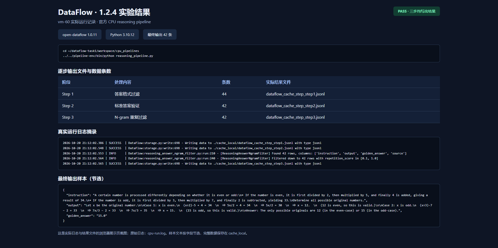

# Task 1：1.1 至 1.2.4

[完整报告](Task1_实验报告.md) · [实验截图](Task1_1.2.4_实验结果.png) · [验收结果](verification.json)



## 已完成的实验

1. 安装 open-dataflow 1.0.11，并完成 `dataflow init`。
2. 运行官方 `reasoning_pipeline.py`，三个非空输出分别为 44、42、42 条。
3. 完成 KBC 模式的 `dataflow pdf2model init`。
4. 从两页示例 PDF 提取 10 个文本块，通过 DataFlow 和本机 Ollama 生成 20 组候选问答；原文匹配筛选 7 组，人工审核保留 5 组。
5. 4 条训练、1 条留出，执行 48 步真实 GPU LoRA 微调。独立进程重载保存文件，24 个张量与落盘权重逐项一致，并完成回答对比。

## 公开材料与运行环境

仓库保留代码、数据、日志、报告和结果截图。基座、LoRA 权重、tokenizer、虚拟环境和实验材料 ZIP 不入 Git；它们仍保存在原实验机的 `~/dataflow-task1/`。证据中的用户目录统一替换为 `<REMOTE_HOME>`，未改动数值或实验结果。

`verification.json` 是原机完整验收记录。运行仓库版 `verify_task1.py` 默认检查公开材料；使用 `--require-adapter` 时还要求本机存在已保存权重。

原始 `train_pdf_lora.py` 末尾的第二命名 adapter 损失断言未通过，保留该失败记录；48 步训练和权重保存已完成。随后 `recover_verification.py` 在独立进程重新加载保存文件、逐项比对权重并重复评估，最终通过。复现时应接着运行复核脚本，不能把原断言说成已通过。

## 运行入口

需要 Python 3.10、DataFlow 1.0.11，以及与本机 CUDA 匹配的 PyTorch；PDF 实验另需 PyMuPDF、Transformers 5.16.1、PEFT 0.18.1、safetensors、Ollama 和本地 Qwen3.5-2B 权重。GPU 训练环境与 DataFlow 环境在原机分开使用，详见报告。

```bash
# 从本目录运行官方 CPU 示例（需事先安装运行依赖）
cd workspace/cpu_pipelines
python reasoning_pipeline.py

# 从本目录检查公开证据
cd ../..
python verify_task1.py

# PDF 原文：从 dataflow init 自带 example_data/KBCleaningPipeline/
# 复制 bitter_lesson.pdf 到 pdf2model/；原文来源见下方。
cd pdf2model
export DF_BASE_MODEL=/path/to/local/Qwen3.5-2B
python pdf_to_model_pipeline.py
python train_pdf_lora.py
python recover_verification.py
python chat_pdf_lora.py "What is the main lesson from the bitter lesson?"
```

PDF 提取与问答合成脚本连接已有的本机 Ollama `qwen3:0.6b`，无需云端密钥。初始生成数据和人工审核划分均在本目录保存，便于区分候选数据与最终训练数据。仓库中的脚本沿用实验原始版本，除模型路径改为环境变量外不改写训练过程。

原文：[Richard Sutton, The Bitter Lesson (2019)](http://www.incompleteideas.net/IncIdeas/BitterLesson.html)。示例 PDF 来自 DataFlow 初始化材料；仓库不重复分发 PDF 和页面图片。官方 CPU 示例及示例数据来自 [OpenDCAI/DataFlow](https://github.com/OpenDCAI/DataFlow)（Apache-2.0）。
